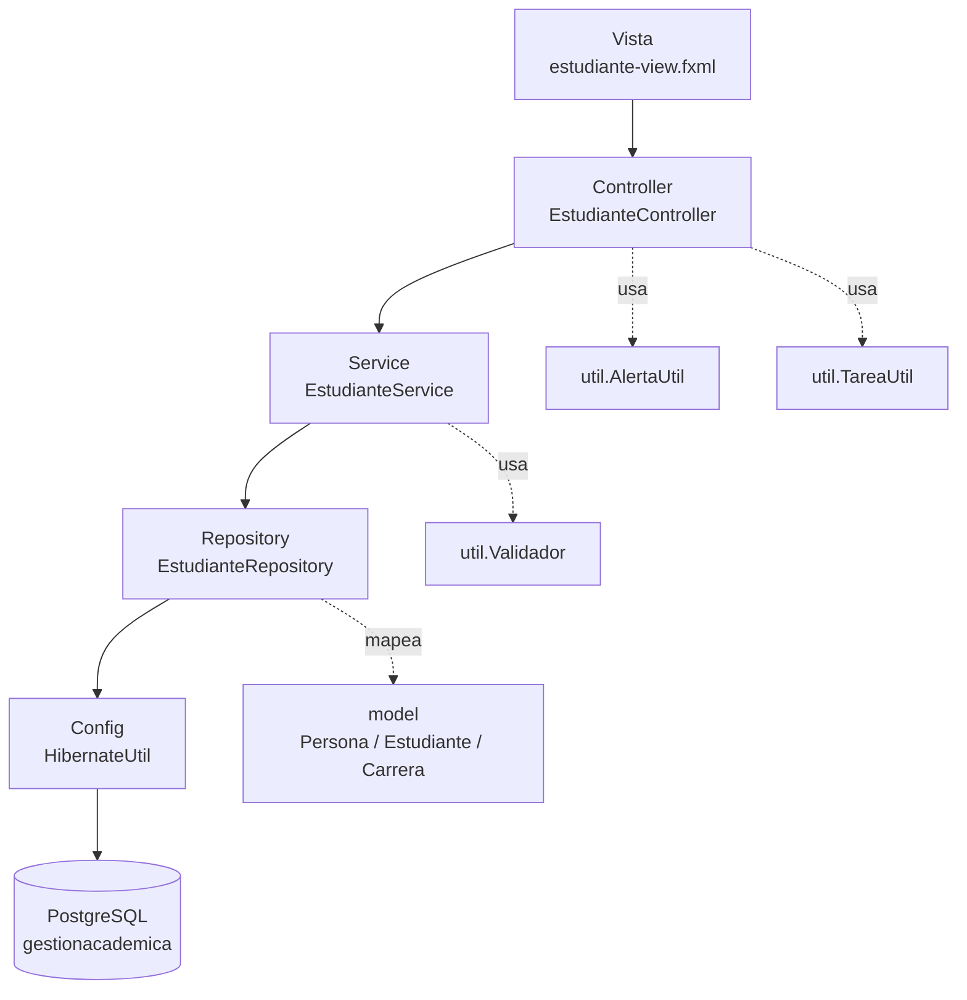
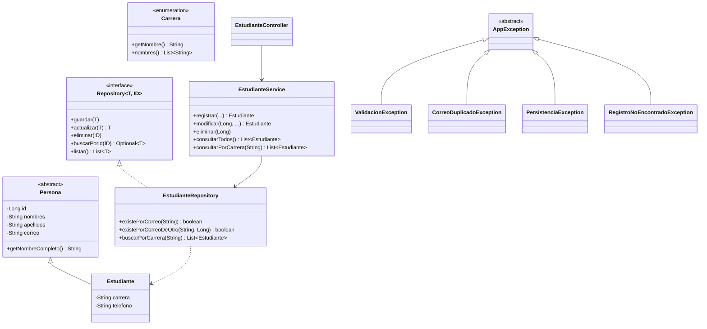
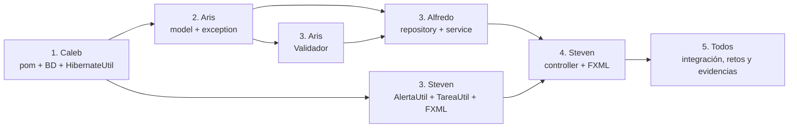

# GestionAcademicaORM

Sistema de Gestión Académica de escritorio construido con **JavaFX**, **Hibernate ORM** y **PostgreSQL**.
Permite registrar, consultar, modificar, eliminar y filtrar estudiantes (CRUD completo), con validaciones y alertas al usuario.

> Universidad Americana (UAM) · Programación de Aplicaciones de Escritorio · Ingeniería de Sistemas de Información
> Práctica guiada de laboratorio · 180 minutos · 40 puntos

---

## Tabla de contenido

1. [Equipo](#1-equipo)
2. [Tecnologías](#2-tecnologías)
3. [Requisitos funcionales](#3-requisitos-funcionales)
4. [Arquitectura](#4-arquitectura)
5. [Estructura del proyecto](#5-estructura-del-proyecto)
6. [Clases y métodos (contrato del proyecto)](#6-clases-y-métodos-contrato-del-proyecto)
7. [Asignaciones por integrante](#7-asignaciones-por-integrante)
8. [Orden de trabajo e integración](#8-orden-de-trabajo-e-integración)
9. [Configuración y ejecución](#9-configuración-y-ejecución)
10. [Manejo de alertas y errores](#10-manejo-de-alertas-y-errores)
11. [Flujo de trabajo con Git](#11-flujo-de-trabajo-con-git)
12. [Rúbrica y evidencias de entrega](#12-rúbrica-y-evidencias-de-entrega)
13. [Preguntas de análisis y retos](#13-preguntas-de-análisis-y-retos)

---

## 1. Equipo

| Integrante | Rol principal | Capa / módulo a cargo |
|---|---|---|
| **Caleb** | Infraestructura y configuración | `config`, `MainApp`, `pom.xml`, base de datos, evidencias |
| **Aris** | Dominio y validaciones | `model`, `exception`, `util.Validador` |
| **Alfredo** | Persistencia y lógica de negocio | `repository`, `service` |
| **Steven** | Interfaz de usuario | `controller`, FXML, `util.AlertaUtil`, `util.TareaUtil` |

---

## 2. Tecnologías

| Tecnología | Versión | Uso |
|---|---|---|
| Java | 21 | Lenguaje |
| Maven | 3.9+ | Gestión de dependencias |
| JavaFX (`javafx-controls`, `javafx-fxml`) | 21.x (verificar la última disponible) | Interfaz gráfica |
| Hibernate ORM (`hibernate-core`) | 6.6.11.Final | ORM / JPA |
| PostgreSQL JDBC (`postgresql`) | 42.7.4 | Driver de conexión |
| PostgreSQL + pgAdmin 4 | 15+ | Base de datos |
| IntelliJ IDEA | Cualquiera reciente | IDE |

---

## 3. Requisitos funcionales

Los RF01–RF05 vienen de la guía; RF06–RF08 completan el CRUD y las alertas.

| Código | Requisito | Responsable principal | Dónde se implementa |
|---|---|---|---|
| RF01 | Registrar nombres, apellidos, correo y carrera | Alfredo / Steven | `EstudianteService.registrar()` · `EstudianteController.onGuardar()` |
| RF02 | Consultar estudiantes registrados | Alfredo / Steven | `EstudianteRepository.listar()` · `EstudianteController.onConsultar()` |
| RF03 | Mostrar resultados en `TableView` | Steven | `EstudianteController.refrescarTabla()` |
| RF04 | Validar campos obligatorios | Aris | `Validador.requerido()` · `ValidacionException` |
| RF05 | Evitar correos duplicados | Alfredo | `EstudianteRepository.existePorCorreo()` · `CorreoDuplicadoException` |
| RF06 | Modificar un estudiante | Alfredo / Steven | `EstudianteService.modificar()` · `EstudianteController.onActualizar()` |
| RF07 | Eliminar un estudiante con confirmación | Alfredo / Steven | `EstudianteService.eliminar()` · `AlertaUtil.confirmar()` |
| RF08 | Alertas claras de éxito, advertencia y error | Steven | `AlertaUtil` |
| RF09 | Filtrar estudiantes por carrera (HQL parametrizada) | Alfredo | `EstudianteRepository.buscarPorCarrera()` |

### CRUD

| Operación | Capa UI | Servicio | Repositorio |
|---|---|---|---|
| **C**reate | `onGuardar()` | `registrar()` | `guardar()` |
| **R**ead | `onConsultar()` / `onFiltrar()` | `consultarTodos()` / `consultarPorCarrera()` | `listar()` / `buscarPorCarrera()` |
| **U**pdate | `onActualizar()` | `modificar()` | `actualizar()` |
| **D**elete | `onEliminar()` | `eliminar()` | `eliminar()` |

---

## 4. Arquitectura

Arquitectura en capas con **programación orientada a objetos**: cada capa tiene una única responsabilidad y solo conoce a la capa inmediatamente inferior.



**Por qué las consultas no van en el controlador JavaFX:** el controlador solo debe manejar eventos y mostrar datos. Si contiene HQL/SQL se mezcla la UI con el acceso a datos, no se puede reutilizar ni probar, y es fácil bloquear el hilo de JavaFX. Por eso el acceso a datos vive en `repository`, las reglas de negocio en `service` y el controlador solo coordina.

### Principios POO aplicados

| Principio | Dónde se aplica |
|---|---|
| **Encapsulamiento** | Atributos `private` con getters/setters en `Persona` y `Estudiante`; `HibernateUtil` con constructor privado |
| **Herencia** | `Estudiante extends Persona`; `ValidacionException`, `CorreoDuplicadoException`, etc. extienden `AppException` |
| **Abstracción / polimorfismo** | Interfaz genérica `Repository<T, ID>` implementada por `EstudianteRepository` |
| **Responsabilidad única** | Una clase = una tarea (validar, persistir, mostrar alertas, ejecutar en segundo plano) |
| **Bajo acoplamiento** | El controlador depende del `Service`, nunca de Hibernate directamente |

### Diagrama de clases



---

## 5. Estructura del proyecto

```
GestionAcademicaORM/
├── pom.xml
├── README.md
├── .gitignore                      # ignora hibernate.properties
└── src/
    ├── main/
    │   ├── java/edu/gestionacademica/
    │   │   ├── MainApp.java
    │   │   │
    │   │   ├── config/
    │   │   │   └── HibernateUtil.java
    │   │   │
    │   │   ├── model/
    │   │   │   ├── Persona.java
    │   │   │   ├── Estudiante.java
    │   │   │   └── Carrera.java
    │   │   │
    │   │   ├── exception/
    │   │   │   ├── AppException.java
    │   │   │   ├── ValidacionException.java
    │   │   │   ├── CorreoDuplicadoException.java
    │   │   │   ├── RegistroNoEncontradoException.java
    │   │   │   └── PersistenciaException.java
    │   │   │
    │   │   ├── repository/
    │   │   │   ├── Repository.java
    │   │   │   └── EstudianteRepository.java
    │   │   │
    │   │   ├── service/
    │   │   │   └── EstudianteService.java
    │   │   │
    │   │   ├── controller/
    │   │   │   └── EstudianteController.java
    │   │   │
    │   │   └── util/
    │   │       ├── Validador.java
    │   │       ├── AlertaUtil.java
    │   │       └── TareaUtil.java
    │   │
    │   └── resources/
    │       ├── hibernate.properties            # local, NO se sube al repo
    │       ├── hibernate.properties.example    # plantilla sin credenciales
    │       └── edu/gestionacademica/
    │           ├── estudiante-view.fxml
    │           └── estilos.css
    │
    └── test/java/edu/gestionacademica/
        ├── util/ValidadorTest.java
        └── service/EstudianteServiceTest.java
```

> `module-info.java` es opcional. Si se usa, debe abrir `edu.gestionacademica.model` a Hibernate y `edu.gestionacademica.controller` a `javafx.fxml`.

---

## 6. Clases y métodos (contrato del proyecto)

Estas firmas son el **contrato** entre integrantes: se respetan tal cual para poder trabajar en paralelo sin bloquearse. Si alguien necesita cambiar una firma, avisa al grupo antes.

### 6.1 Paquete `config` — *Caleb*

**`HibernateUtil`** (`public final class`, constructor privado)

| Miembro | Descripción |
|---|---|
| `private static final SessionFactory FACTORY` | Única instancia de `SessionFactory` |
| `private static SessionFactory crear()` | Lee `hibernate.properties`, registra `Estudiante` con `addAnnotatedClass` y construye la fábrica |
| `public static SessionFactory getSessionFactory()` | Devuelve la fábrica |
| `public static void cerrar()` | Cierra la fábrica al terminar la aplicación |

**`MainApp`** (`extends javafx.application.Application`)

| Método | Descripción |
|---|---|
| `start(Stage stage)` | Carga `estudiante-view.fxml`, aplica `estilos.css` y muestra la ventana |
| `stop()` | Llama a `HibernateUtil.cerrar()` |
| `main(String[] args)` | Lanza la aplicación |

### 6.2 Paquete `model` — *Aris*

**`Persona`** (`abstract`, `@MappedSuperclass`)

| Atributo | Mapeo |
|---|---|
| `Long id` | `@Id @GeneratedValue(strategy = GenerationType.IDENTITY)` |
| `String nombres` | `@Column(nullable = false, length = 100)` |
| `String apellidos` | `@Column(nullable = false, length = 100)` |
| `String correo` | `@Column(nullable = false, unique = true, length = 150)` |

Métodos: constructor vacío, constructor completo, getters y setters, `getNombreCompleto()`.

**`Estudiante extends Persona`** (`@Entity @Table(name = "estudiantes")`)

| Atributo | Mapeo |
|---|---|
| `String carrera` | `@Column(nullable = false, length = 100)` |
| `String telefono` | `@Column(length = 20)` — *Reto 1* |

Métodos: `Estudiante()`, `Estudiante(String nombres, String apellidos, String correo, String carrera)`, getters y setters, `equals()`, `hashCode()` (por `id`), `toString()`.

**`Carrera`** (`enum`)

| Miembro | Descripción |
|---|---|
| Constantes | `INGENIERIA_SISTEMAS`, `ADMINISTRACION`, `CONTADURIA`, `DERECHO`, `ARQUITECTURA`, etc. (a definir por el grupo) |
| `getNombre()` | Texto legible para el `ComboBox` |
| `static List<String> nombres()` | Lista de nombres para llenar `cmbCarrera` |

### 6.3 Paquete `exception` — *Aris*

| Clase | Extiende | Cuándo se lanza |
|---|---|---|
| `AppException` | `RuntimeException` | Base abstracta de todas las excepciones del sistema |
| `ValidacionException` | `AppException` | Campo obligatorio vacío, formato inválido o longitud excedida. Guarda una `List<String> errores` con `getErrores()` |
| `CorreoDuplicadoException` | `AppException` | Ya existe un estudiante con ese correo |
| `RegistroNoEncontradoException` | `AppException` | Se intenta modificar o eliminar un `id` inexistente |
| `PersistenciaException` | `AppException` | Falla de Hibernate o de la base de datos (envuelve la causa original) |

### 6.4 Paquete `util` — validaciones (*Aris*) y UI (*Steven*)

**`Validador`** (*Aris* · `final class`, métodos `static`)

| Método | Descripción |
|---|---|
| `String normalizar(String valor)` | `trim()` y convierte `null` en cadena vacía |
| `void requerido(String valor, String campo)` | Lanza `ValidacionException` si está vacío (RF04) |
| `void longitudMaxima(String valor, int max, String campo)` | Valida el tope definido en `@Column` |
| `void formatoCorreo(String correo)` | Valida con expresión regular |
| `void formatoTelefono(String telefono)` | Opcional; solo dígitos, espacios y `+ -` |
| `void validarEstudiante(String nombres, String apellidos, String correo, String carrera, String telefono)` | Ejecuta todas las validaciones y acumula **todos** los errores en una sola `ValidacionException` |

**`AlertaUtil`** (*Steven* · `final class`, métodos `static`)

| Método | Tipo de alerta |
|---|---|
| `void mostrarExito(String mensaje)` | `INFORMATION` |
| `void mostrarInformacion(String titulo, String mensaje)` | `INFORMATION` |
| `void mostrarAdvertencia(String titulo, String mensaje)` | `WARNING` |
| `void mostrarError(String titulo, String mensaje)` | `ERROR` |
| `void mostrarErrores(String titulo, List<String> errores)` | `WARNING` con lista de errores de validación |
| `boolean confirmar(String titulo, String mensaje)` | `CONFIRMATION`; devuelve `true` si el usuario acepta |

**`TareaUtil`** (*Steven* · `final class`, métodos `static`)

| Método | Descripción |
|---|---|
| `<T> void ejecutar(Supplier<T> trabajo, Consumer<T> alExito, Consumer<Throwable> alFallar)` | Corre `trabajo` en un `javafx.concurrent.Task` en segundo plano; `alExito` y `alFallar` se ejecutan en el hilo de JavaFX |
| `void ejecutar(Runnable trabajo, Runnable alExito, Consumer<Throwable> alFallar)` | Variante sin valor de retorno (guardar, eliminar) |
| `void bloquear(Node... controles)` / `void desbloquear(Node... controles)` | Deshabilita y habilita controles mientras corre la tarea |

### 6.5 Paquete `repository` — *Alfredo*

**`Repository<T, ID>`** (interfaz genérica)

| Método | Descripción |
|---|---|
| `void guardar(T entidad)` | Inserta (`persist`) |
| `T actualizar(T entidad)` | Actualiza (`merge`) |
| `void eliminar(ID id)` | Elimina por identificador |
| `Optional<T> buscarPorId(ID id)` | Busca por clave primaria |
| `List<T> listar()` | Devuelve todos los registros |

**`EstudianteRepository implements Repository<Estudiante, Long>`**

| Método | Descripción |
|---|---|
| `void guardar(Estudiante e)` | `beginTransaction` → `persist` → `commit`; `rollback` si falla |
| `Estudiante actualizar(Estudiante e)` | Igual con `merge` |
| `void eliminar(Long id)` | Busca y elimina dentro de una transacción |
| `Optional<Estudiante> buscarPorId(Long id)` | `session.find(...)` |
| `List<Estudiante> listar()` | `FROM Estudiante` |
| `boolean existePorCorreo(String correo)` | Para RF05 al registrar |
| `boolean existePorCorreoDeOtro(String correo, Long idExcluido)` | Para RF05 al modificar |
| `List<Estudiante> buscarPorCarrera(String carrera)` | HQL parametrizada: `FROM Estudiante e WHERE e.carrera = :carrera` — *Reto 3* |
| `private <R> R ejecutarEnTransaccion(Function<Session, R> accion)` | Evita repetir apertura de sesión, commit y rollback en cada método |

> Todos los métodos capturan `RuntimeException` de Hibernate y lanzan `PersistenciaException`. Si la violación es por `UNIQUE(correo)` lanzan `CorreoDuplicadoException`.

### 6.6 Paquete `service` — *Alfredo*

**`EstudianteService`** (recibe `EstudianteRepository` por constructor)

| Método | Descripción |
|---|---|
| `Estudiante registrar(String nombres, String apellidos, String correo, String carrera, String telefono)` | Valida con `Validador` → verifica correo duplicado → crea `Estudiante` → `guardar` |
| `Estudiante modificar(Long id, String nombres, String apellidos, String correo, String carrera, String telefono)` | Valida → verifica que exista → verifica correo duplicado de otro → `actualizar` |
| `void eliminar(Long id)` | Verifica que exista y elimina |
| `Optional<Estudiante> buscarPorId(Long id)` | Consulta individual |
| `List<Estudiante> consultarTodos()` | Delegado a `listar()` |
| `List<Estudiante> consultarPorCarrera(String carrera)` | Delegado a `buscarPorCarrera()` |

### 6.7 Paquete `controller` y vista — *Steven*

**Identificadores FXML**

| Control | `fx:id` | Origen |
|---|---|---|
| `TextField` | `txtNombres` | Guía |
| `TextField` | `txtApellidos` | Guía |
| `TextField` | `txtCorreo` | Guía |
| `ComboBox<String>` | `cmbCarrera` | Guía |
| `Button` | `btnGuardar` | Guía |
| `Button` | `btnConsultar` | Guía |
| `TableView<Estudiante>` | `tablaEstudiantes` | Guía |
| `TextField` | `txtTelefono` | Reto 1 |
| `Button` | `btnActualizar` | CRUD |
| `Button` | `btnEliminar` | CRUD |
| `Button` | `btnLimpiar` | CRUD |
| `ComboBox<String>` | `cmbFiltroCarrera` | Reto 3 |
| `Button` | `btnFiltrar` | Reto 3 |
| `TableColumn` | `colId`, `colNombres`, `colApellidos`, `colCorreo`, `colCarrera`, `colTelefono` | Tabla |

**`EstudianteController`** (`implements Initializable`)

| Método | Descripción |
|---|---|
| `initialize(URL, ResourceBundle)` | Crea el `EstudianteService`, configura la tabla, carga las carreras y registra el listener de selección |
| `private void configurarTabla()` | Enlaza cada columna con `PropertyValueFactory` |
| `private void cargarCarreras()` | Llena `cmbCarrera` y `cmbFiltroCarrera` con `Carrera.nombres()` |
| `@FXML void onGuardar()` | Lee el formulario → `TareaUtil` → `service.registrar()` → alerta de éxito → limpia → refresca (RF01) |
| `@FXML void onConsultar()` | `service.consultarTodos()` en segundo plano → `refrescarTabla()` (RF02) |
| `@FXML void onActualizar()` | Modifica el estudiante seleccionado (RF06) |
| `@FXML void onEliminar()` | `AlertaUtil.confirmar()` → `service.eliminar()` (RF07) |
| `@FXML void onFiltrar()` | `service.consultarPorCarrera()` |
| `@FXML void onLimpiar()` | Limpia el formulario y la selección |
| `private void onFilaSeleccionada(Estudiante e)` | Carga el estudiante seleccionado en el formulario y habilita Actualizar/Eliminar |
| `private void llenarFormulario(Estudiante e)` | Pasa los datos del objeto a los controles |
| `private void limpiarFormulario()` | Vacía campos y `cmbCarrera` |
| `private void refrescarTabla(List<Estudiante> lista)` | Reemplaza los items de `tablaEstudiantes` (RF03) |
| `private void manejarError(Throwable t)` | Traduce cada excepción a la alerta correcta (ver [sección 10](#10-manejo-de-alertas-y-errores)) |

---

## 7. Asignaciones por integrante

### Caleb — Infraestructura y configuración

**Puntos de rúbrica:** Configuración JavaFX/Hibernate/PostgreSQL (8) + Generación y verificación de tabla (6)

| # | Tarea | Entregable |
|---|---|---|
| 1 | Crear el proyecto Maven `GestionAcademicaORM` con Java 21 y subirlo al repositorio | Repo inicial con ramas |
| 2 | Configurar `pom.xml`: `javafx-controls`, `javafx-fxml`, `hibernate-core 6.6.11.Final`, `postgresql 42.7.4`, `javafx-maven-plugin` y JUnit | `pom.xml` |
| 3 | Crear la base `gestionacademica` desde pgAdmin 4 (sin crear la tabla a mano) | Base lista |
| 4 | Crear `hibernate.properties` local y `hibernate.properties.example`; configurar `.gitignore` | Sin credenciales en el repo |
| 5 | Implementar `HibernateUtil` (`getSessionFactory`, `cerrar`) | `HibernateUtil.java` |
| 6 | Implementar `MainApp` (`start`, `stop`, `main`) | `MainApp.java` |
| 7 | Verificar que Hibernate crea la tabla `estudiantes` y capturar `SELECT * FROM estudiantes;` | Captura de pgAdmin |
| 8 | Compilar las capturas, la reflexión Hibernate vs JDBC y mantener este README | Carpeta `evidencias/` |

**Preguntas de análisis a su cargo:** diferencia entre `hbm2ddl.auto=create` y `update`, qué hace el dialecto, qué pasa si el puerto de PostgreSQL es distinto.

---

### Aris — Dominio y validaciones

**Puntos de rúbrica:** Entidad y mapeo (8) + parte de Análisis y retos (4)

| # | Tarea | Entregable |
|---|---|---|
| 1 | Implementar `Persona` (`@MappedSuperclass`) con `id`, `nombres`, `apellidos`, `correo` | `Persona.java` |
| 2 | Implementar `Estudiante` (`@Entity`, `@Table`, `@Column`) con `carrera` y `telefono` | `Estudiante.java` |
| 3 | Implementar el enum `Carrera` con `getNombre()` y `nombres()` | `Carrera.java` |
| 4 | Implementar la jerarquía de excepciones (`AppException` y 4 derivadas) | Paquete `exception` |
| 5 | Implementar `Validador` con todos sus métodos y acumulación de errores | `Validador.java` |
| 6 | Pruebas unitarias de `Validador` (campos vacíos, correo inválido, longitudes) | `ValidadorTest.java` |
| 7 | **Reto 1:** agregar `telefono` y comprobar el cambio de esquema generado por Hibernate | Captura antes y después |

> **Prioridad:** Aris entrega `model` y `exception` primero (son la base del resto). Hacer *push* en cuanto compilen, aunque `Validador` aún no esté.

**Preguntas de análisis a su cargo:** describir `@Entity`, `@Table`, `@Id`, `@GeneratedValue` y `@Column`; correspondencia clase ↔ tabla, atributo ↔ columna, objeto ↔ fila.

---

### Alfredo — Persistencia y lógica de negocio

**Puntos de rúbrica:** Operaciones de persistencia (8) + parte de Análisis y retos (4)

| # | Tarea | Entregable |
|---|---|---|
| 1 | Definir la interfaz genérica `Repository<T, ID>` | `Repository.java` |
| 2 | Implementar `EstudianteRepository`: `guardar`, `actualizar`, `eliminar`, `buscarPorId`, `listar` con transacciones y `rollback` | `EstudianteRepository.java` |
| 3 | Implementar `ejecutarEnTransaccion(...)` para no duplicar código | Método privado |
| 4 | Implementar `existePorCorreo` y `existePorCorreoDeOtro` | RF05 |
| 5 | Implementar `EstudianteService`: `registrar`, `modificar`, `eliminar`, `buscarPorId`, `consultarTodos`, `consultarPorCarrera` | `EstudianteService.java` |
| 6 | Traducir errores de Hibernate a `PersistenciaException` / `CorreoDuplicadoException` | Manejo de errores |
| 7 | **Reto 2:** probar dos estudiantes con el mismo correo y garantizar un mensaje claro | Captura del mensaje |
| 8 | **Reto 3:** HQL parametrizada `buscarPorCarrera` | Método + prueba |
| 9 | Pruebas del servicio (con *mock* o base de pruebas) | `EstudianteServiceTest.java` |

**Preguntas de análisis a su cargo:** diferencia entre `SessionFactory`, `Session`, `Transaction`, `persist` y `rollback`; por qué hay que cerrar bien las transacciones; por qué sigue siendo importante conocer SQL.

---

### Steven — Interfaz de usuario y alertas

**Puntos de rúbrica:** Integración JavaFX y validación (6) + parte de Análisis y retos (4)

| # | Tarea | Entregable |
|---|---|---|
| 1 | Diseñar `estudiante-view.fxml` con todos los `fx:id` de la sección 6.7 | FXML |
| 2 | Crear `estilos.css` (colores, espaciado, estados deshabilitados) | CSS |
| 3 | Implementar `AlertaUtil` (éxito, información, advertencia, error, lista de errores, confirmación) | `AlertaUtil.java` |
| 4 | Implementar `TareaUtil` (`Task` en segundo plano, bloquear/desbloquear controles) | `TareaUtil.java` |
| 5 | Implementar `EstudianteController`: guardar, consultar, actualizar, eliminar, filtrar, limpiar | `EstudianteController.java` |
| 6 | Configurar el `TableView` y la selección de fila que llena el formulario | RF03 |
| 7 | Implementar `manejarError(Throwable)` con la alerta adecuada por excepción | Sección 10 |
| 8 | Capturas del flujo completo: registro, consulta, edición, eliminación, alertas | Carpeta `evidencias/` |

**Preguntas de análisis a su cargo:** por qué las consultas no deben escribirse en el controlador; por qué las operaciones de base de datos van en un `Task` y no en el hilo de JavaFX.

---

### Resumen de carga

| Integrante | Clases | Rúbrica principal | Dependencias |
|---|---|---|---|
| Caleb | `HibernateUtil`, `MainApp`, `pom.xml` | 14 pts | Ninguna (arranca primero) |
| Aris | `Persona`, `Estudiante`, `Carrera`, 5 excepciones, `Validador` | 8 pts | Necesita a Caleb para probar el esquema |
| Alfredo | `Repository`, `EstudianteRepository`, `EstudianteService` | 8 pts | Necesita `model` y `exception` de Aris |
| Steven | `AlertaUtil`, `TareaUtil`, `EstudianteController`, FXML, CSS | 6 pts | Necesita `service` de Alfredo (puede avanzar con datos simulados) |

El bloque de **Análisis y retos (4 pts)** se reparte entre los cuatro según las preguntas indicadas arriba.

---

## 8. Orden de trabajo e integración



| Etapa | Qué pasa | Cierre |
|---|---|---|
| 1 | Caleb publica el proyecto base con dependencias, `HibernateUtil` y la base creada | Todos pueden clonar y compilar |
| 2 | Aris publica `model` y `exception`; Steven avanza con FXML, `AlertaUtil` y `TareaUtil` (no dependen de la BD) | Hibernate crea la tabla `estudiantes` |
| 3 | Alfredo implementa `repository` y `service`; Aris termina `Validador` | CRUD funcionando por consola o prueba |
| 4 | Steven conecta el controlador con el servicio | CRUD funcionando desde la UI |
| 5 | Retos 1–3, pruebas, capturas y reflexión | Entrega final |

---

## 9. Configuración y ejecución

### 9.1 Base de datos

Desde pgAdmin 4, conectado a la base `postgres`:

```sql
CREATE DATABASE gestionacademica;
```

Luego abrir una conexión a `gestionacademica`. **No crear la tabla `estudiantes`**: la genera Hibernate. (La guía incluye un `GO` después del `CREATE DATABASE`; no aplica en PostgreSQL.)

### 9.2 `hibernate.properties`

Copiar `hibernate.properties.example` a `src/main/resources/hibernate.properties` y completar los datos locales:

```properties
hibernate.connection.driver_class=org.postgresql.Driver
hibernate.connection.url=jdbc:postgresql://localhost:5432/gestionacademica
hibernate.connection.username=usuario_laboratorio
hibernate.connection.password=CLAVE_LOCAL
hibernate.dialect=org.hibernate.dialect.PostgreSQLDialect
hibernate.hbm2ddl.auto=update
hibernate.show_sql=true
hibernate.format_sql=true
```

> La guía muestra `org.postgresql.jdbc.PostgreSQLDriver` como `driver_class`; la clase del driver 42.x es `org.postgresql.Driver`. Si Hibernate no encuentra el driver, revisar este valor.

> **Seguridad:** usar credenciales exclusivas del laboratorio. Para conexiones remotas configurar TLS con verificación de certificados. **Nunca subir `hibernate.properties` al repositorio** (está en `.gitignore`).

### 9.3 `.gitignore` mínimo

```
target/
.idea/
*.iml
src/main/resources/hibernate.properties
```

### 9.4 Dependencias Maven

```xml
<dependency>
    <groupId>org.hibernate.orm</groupId>
    <artifactId>hibernate-core</artifactId>
    <version>6.6.11.Final</version>
</dependency>
<dependency>
    <groupId>org.postgresql</groupId>
    <artifactId>postgresql</artifactId>
    <version>42.7.4</version>
</dependency>
<dependency>
    <groupId>org.openjfx</groupId>
    <artifactId>javafx-controls</artifactId>
    <version>21.0.x</version> <!-- verificar versión disponible -->
</dependency>
<dependency>
    <groupId>org.openjfx</groupId>
    <artifactId>javafx-fxml</artifactId>
    <version>21.0.x</version> <!-- misma versión que controls -->
</dependency>
```

### 9.5 Ejecutar

```bash
mvn clean javafx:run
```

O desde IntelliJ IDEA: ejecutar `MainApp`. Con `hibernate.hbm2ddl.auto=update`, la tabla se crea en el primer arranque; comprobar con:

```sql
SELECT * FROM estudiantes;
```

---

## 10. Manejo de alertas y errores

Regla de oro: **las capas inferiores lanzan excepciones; solo el controlador muestra alertas.**

| Situación | Excepción | Alerta (`AlertaUtil`) | Mensaje de ejemplo |
|---|---|---|---|
| Registro o edición correctos | — | `mostrarExito` | "Estudiante guardado correctamente." |
| Campos obligatorios vacíos / formato inválido | `ValidacionException` | `mostrarErrores` | "Corrige lo siguiente: • Nombres es obligatorio • El correo no es válido" |
| Correo ya registrado | `CorreoDuplicadoException` | `mostrarAdvertencia` | "Ya existe un estudiante con el correo ana@uam.edu.ni." |
| Estudiante inexistente (borrado por otro usuario) | `RegistroNoEncontradoException` | `mostrarAdvertencia` | "El registro ya no existe. Actualiza la tabla." |
| Intento de eliminar | — | `confirmar` | "¿Eliminar a Ana Pérez? Esta acción no se puede deshacer." |
| Botón Actualizar/Eliminar sin selección | — | `mostrarAdvertencia` | "Selecciona un estudiante de la tabla." |
| Falla de BD (conexión, puerto, credenciales) | `PersistenciaException` | `mostrarError` | "No se pudo conectar con la base de datos." |
| Consulta sin resultados | — | `mostrarInformacion` | "No hay estudiantes registrados." |

Esquema de `manejarError(Throwable t)`:

```java
private void manejarError(Throwable t) {
    if (t instanceof ValidacionException ve)              AlertaUtil.mostrarErrores("Datos inválidos", ve.getErrores());
    else if (t instanceof CorreoDuplicadoException cd)    AlertaUtil.mostrarAdvertencia("Correo duplicado", cd.getMessage());
    else if (t instanceof RegistroNoEncontradoException r) AlertaUtil.mostrarAdvertencia("No encontrado", r.getMessage());
    else                                                   AlertaUtil.mostrarError("Error inesperado", "No se pudo completar la operación.");
}
```

---

## 11. Flujo de trabajo con Git

**Ramas**

| Rama | Dueño |
|---|---|
| `main` | Solo código integrado y funcionando |
| `develop` | Integración continua del equipo |
| `feature/config-caleb` | Caleb |
| `feature/modelo-aris` | Aris |
| `feature/persistencia-alfredo` | Alfredo |
| `feature/ui-steven` | Steven |

**Reglas**

- Cada integrante trabaja **solo en los archivos de su módulo**; cualquier cambio fuera de él se acuerda antes.
- Se hace *pull request* hacia `develop` y lo revisa al menos otro integrante.
- Mensajes de commit descriptivos y en presente: `Agrega validación de correo en Validador`.
- Nunca se suben `hibernate.properties`, contraseñas ni la carpeta `target/`.

**Definición de terminado (por tarea):** compila sin errores · respeta las firmas del contrato · sin código comentado ni `System.out` de depuración · probado manualmente · PR revisado.

---

## 12. Rúbrica y evidencias de entrega

| Criterio | Puntos | Responsable |
|---|---|---|
| Configuración JavaFX, Hibernate y PostgreSQL | 8 | Caleb |
| Entidad y mapeo | 8 | Aris |
| Generación y verificación de tabla | 6 | Caleb |
| Operaciones de persistencia | 8 | Alfredo |
| Integración JavaFX y validación | 6 | Steven (con Aris en validación) |
| Análisis y retos | 4 | Todos |
| **Total** | **40** | |

**Evidencias a entregar** (compiladas por Caleb):

- [ ] Proyecto Maven completo
- [ ] Archivos de configuración **sin credenciales reales** (`hibernate.properties.example`)
- [ ] Captura de la tabla `estudiantes` generada en PostgreSQL
- [ ] Capturas de registro y consulta en JavaFX
- [ ] Capturas de edición, eliminación y alertas
- [ ] Reflexión breve: Hibernate frente a JDBC
- [ ] Cierre: una ventaja del ORM, una limitación y una mejora para la siguiente versión

---

## 13. Preguntas de análisis y retos

### Preguntas de la guía

| Fase | Pregunta | Responde |
|---|---|---|
| I | ¿Qué significa ORM? ¿Diferencia entre JDBC e Hibernate? ¿Qué representa `@Entity`? ¿Por qué sigue siendo importante conocer SQL? | Aris (ORM, `@Entity`) · Alfredo (JDBC vs Hibernate, SQL) |
| II | ¿Por qué las consultas no deben escribirse en el controlador JavaFX? | Steven |
| III | ¿Diferencia entre `hbm2ddl.auto=create` y `update`? ¿Qué hace el dialecto? ¿Qué ocurre si el puerto es distinto? | Caleb |
| IV | Describir `@Entity`, `@Table`, `@Id`, `@GeneratedValue`, `@Column` | Aris |
| V | Diferencia entre `SessionFactory`, `Session`, `Transaction`, `persist` y `rollback`; por qué cerrar bien las transacciones | Alfredo |
| VI | Por qué la BD va en un `Task` y no en el hilo de JavaFX | Steven |

### Retos de programación

| Reto | Descripción | Responsable |
|---|---|---|
| 1 | Agregar `telefono` y comprobar el cambio de esquema que genera Hibernate | Aris |
| 2 | Registrar dos estudiantes con el mismo correo y mostrar una respuesta clara | Alfredo (lógica) + Steven (alerta) |
| 3 | Consulta HQL parametrizada para filtrar por carrera | Alfredo (`buscarPorCarrera`) + Steven (`cmbFiltroCarrera`) |

---

## Mejoras para una siguiente versión

- Reemplazar `hbm2ddl.auto=update` por migraciones con Flyway o Liquibase.
- Agregar entidades `Materia` e `Inscripcion` (relaciones `@OneToMany` / `@ManyToOne`).
- Paginación y búsqueda por nombre o correo.
- Pool de conexiones (HikariCP) y configuración por perfiles.
- Exportar la tabla a CSV o PDF.
